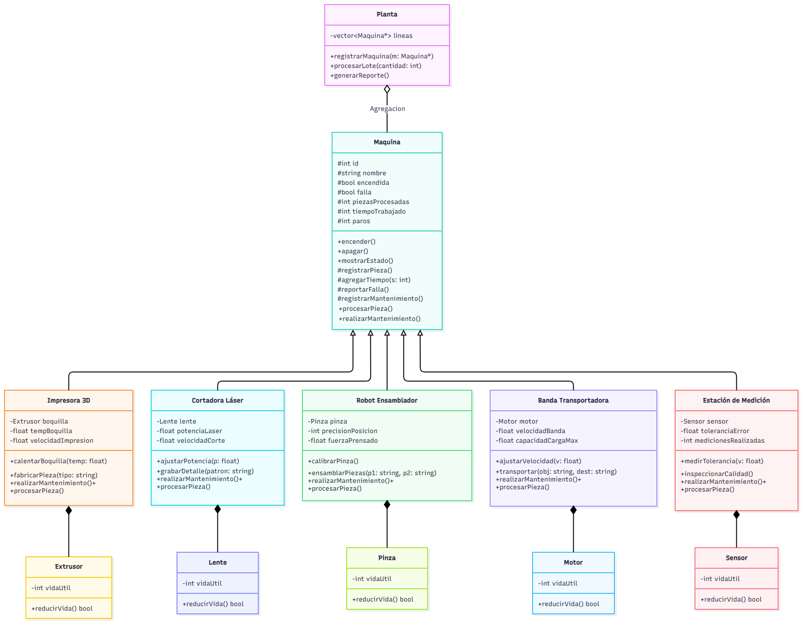

# Simulador de una Planta de Manufactura Automatizada

Proyecto del Parcial 2 de Programación Orientada a Objetos.

La guía completa del proyecto está en [PROYECTO.md](PROYECTO.md). Léanla antes de empezar.

## 1. Equipo

| Bloque | Matrícula | Nombre | Usuario de GitHub | Máquina | Componente |
| --- | --- | --- | --- | --- | --- |
| 1 | 25292 | Yurik David Alarcon Gutierez | Kothy-Web | Robot Ensamblador | Pinza |
| 2 | 25173 | Cesar Leonardo Garrido Gonzalez| clgarridog1604 | Cortadora Laser  | Lente |
| 3 | 26011 | Alejandro Salguero Vega | alexsalguerov-stack | Impresora 3D | Extrusor |
| 4 | 25085 | Jorge Antonio Sadurni Cerdio | Jorge-Sadurni | Banda Transpotadora| Motor |
| 5 | 25176 | Dannia Ximena Plata Palos | dannia-plata | Inspeccion | Sensor |
| 6 (solo equipo de seis) | | | | | |

## 2. Orden de la línea

Escriban el orden en que una pieza recorre las estaciones.

[La impresora 3D fabrica las llantas y el chasis del carrito. La banda transportadora lleva esas piezas a la cortadora láser, donde se realizan los detalles; después las lleva al robot ensamblador, que las une para formar el carrito. Finalmente, la banda transporta el carrito hasta la estación de inspección para el control de calidad.]

## 3. Cómo compilar y ejecutar

Escriban el comando exacto que usa el equipo para compilar y el comando para ejecutar.

 g++ -Wall -Wextra -std=c++17 -I include src/3DP.cpp src/BandaTransportadora.cpp src/CortadoraLaser.cpp src/Estacioninspeccion.cpp src/Lente.cpp src/main.cpp src/Maquina.cpp src/Motor.cpp src/Pinza.cpp src/Planta.cpp src/RobotEnsamblador.cpp src/Sensor.cpp -o simulacion.exe ; .\simulacion.exe 

## 4. Reglas de la simulación

**¿En qué momento exacto falla una máquina?**

La falla ocurre al finalizar el ciclo de procesamiento de la pieza que alcanza el límite de desgaste del componente. La máquina queda inoperativa para el siguiente ciclo hasta que se aplique el mantenimiento.

**¿El mantenimiento suma tiempo al turno? ¿Cuánto?**

Sí, cada operación de mantenimiento suma un tiempo fijo de 120 segundos al tiempo total del turno, simulando el periodo de inactividad necesario para restaurar el componente afectado.

## 5. Cálculo a mano del reporte

Lote de 20 piezas. Una fila por máquina.

| Máquina | Segundos por pieza | Límite del componente | Fallas en 20 piezas | Tiempo trabajado |
| --- | --- | --- | --- | --- |
| Impresora 3D | 180 s | 15 pzs| 1 falla | 3,600 s (60 min)|
| Cortadora Laser| 15 s | 30 pzs| 0 | 300 s (5 min) |
| Insepccion| 25 s | 25pzs | 0 | 500 s (8.3 min) |
| Banda de Transportacion| 10 s | 50pzs| 0 | 200 s (3.3 min) |
| Robot Ensamblador| 8 s | 40 pzs| 0 | 160 s (2.6 min) |

**Reporte esperado (piezas terminadas, tiempo total y paros):**

20 piezas terminadas
1 paro de produccion
3,720 s (62 min)

**¿Coincide con lo que imprime el programa? Si no coincidió al primer intento, ¿qué encontraron?**

Sí, finalmente coincide al 100%. La ejecución final del programa genera de manera exacta las 20 piezas completadas, registra 1 paro por mantenimiento reactivo y acumula un tiempo total de operación de 3,720 segundos (62 minutos).

## 6. Diagrama general

Diagrama de clases de la solución completa, hecho en draw.io. Guarden la imagen como `docs/diagrama_general.png`.

 

## 7. Documentación individual

| Integrante | Documentación de su clase | Propuesta de mejora |
| --- | --- | --- |
| | `docs/<Clase>.md` | `docs/mejoras/<matrícula>/mejora.md` |
| Alejandro Salguero Vega | docs\IMPRESORA3D_CLASE.md | docs\mejoras\26011\IMPRESORA3D_MEJORA.md |
| Jorge Antonio Sadurni Cerdio | docs\BANDA.TRANSPORTADORA.md | docs\mejoras\25085\PLANTILLA_MEJORA_Banda_Transportadora.md |
| Yurik David Alarcon Gtz.| docs\ROBOT ENSAMBLADOR.md| docs\mejoras\25292\PLANTILLA_MEJORA.md|
|César Leonardo Garrido Glz. |docs\PLANTILLA_CLASE Cortadora Laser.md |docs\mejoras\25173\PLANTILLA_MEJORA_CortadoraLaser.md |
|Dannia Ximena Plata Palos| docs\Estacioninspeccion.md| docs\mejoras\25176\PLANTILLA_MEJORA_Estacioninspeccion.md|

## 8. Cambios a `Maquina.h`

Si el equipo modificó la interfaz de la clase base, expliquen qué cambió y por qué. Si no hubo cambios, escriban "Sin cambios".

[Inserta aquí tu respuesta]
