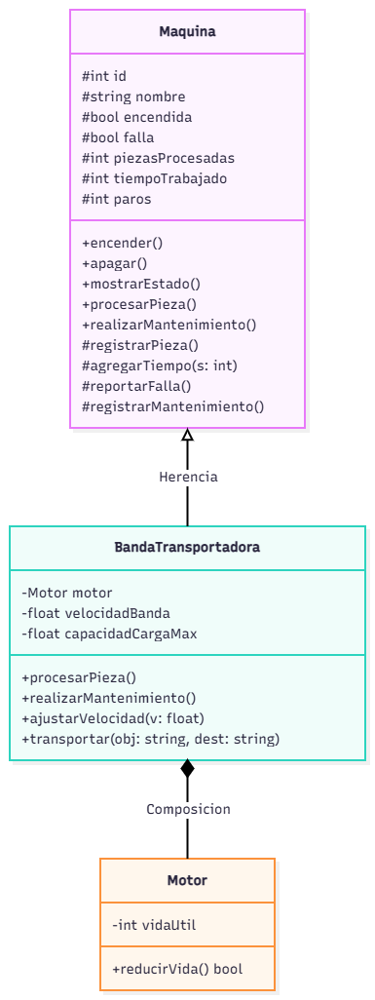

# Documentación de la clase: Banda Trasnportadora

**Elaborada por:** Jorge Antonio Sadurni Cerdio
**Matrícula:** 25085
**Bloque:** 4

## 1. Propósito

**¿Qué máquina representa tu clase y qué operación hace sobre la pieza?**

Banda Transportadora - La banda transportadora es responsable de transladar las partes del carrito de jugete a las siguientes estaciones 

**¿Cuál es su componente y por qué no existe sin la máquina?**

Motor no existe sin la maquina porque su ciclo de 
vida depende de la banda transportadora, si la maquina se destruye el componente deja de existtir.
La funcion del componente motor es generar energia mecanica para que haya movimiento de rotacion y la banda pueda desplazarse sobre sus rodamientos y poleas.

## 2. Decisiones de diseño

**Atributos propios de tu clase y validación de cada uno:**

Los atributos propios de banda son los siguientes:
-float velocidadBanda
-float capacidadCargaMax
-Motor

La primera validacion es de velocidadBanda, valida que la banda se este moviendo cuanto sea requerida con la 
 condicion de que sea mayor a 0m/s y que tenga una velocidad maxima de 5m/s.
 La segunda validacion es de de capacidadCargaMax, se asegura de que el peso sea mayor a 0Kgs y establce un limite 
 10Kg.

**Métodos propios (los que la clase base no tiene):**

Metodos propios de la clase derivada:
+ajustarVelocidad(v: float)
+transportar(obj:string, dest:string)

**Método de la base que redefines, y cómo reutilizas la versión de la base:**

Metodos de la base que se redifinieron:
+procesarPieza();
+realizarMantenimiento

La clase de banda transportadora llama a Maquina::procesarPieza como todas las 5 maquinas para sumar una pieza al lote y el tiempo acumulado de trabajo y de manera individual agrega el desgaste del motor de la maquina derivada. Por otro lado, la clase llama Maquina::realizarMantenimiento para quitar la falla y anotar el paro de produccion y por aparte restablece la vida util del componente de desgaste.

**¿Cómo modelaste el desgaste del componente y por qué así?**

Modele el desgaste del componenete como una relacion de composicion (HAS-A) entre la banda trasnportadora y motor. La banda tiene la resposabilidad de mover las partes del carrito, sin embargo, no necsita saber los detalles internos de la vida util del componente o su degradacion. Finalmente al separar estos dos elementos, la maquina puede consultar el estado del componente antes de trabajar.

**¿Qué usa tu clase de `Maquina` y qué agrega?**

Usa los medotos de realizarMantenimiento y ProcesarPieza de maquina, los cuales los redefine. Agrega los atributos propios
de velocidadBanda, capacidadCargaMax y Motor y sus metodos independientes de ajustarVelocidad y transportar.

## 3. Diagrama

Diagrama de tu clase y su componente, hecho en draw.io. Debe mostrar la relación de herencia con `Maquina` y la de composición con tu componente. Guarda la imagen en `docs/` y enlázala aquí.

## 4. Bitácora

**Dudas que tuviste y cómo las resolviste:**

Las dudas que tuve fueron, cuales metodos esenciales tiene que tener la clase derivada, banda transportadora , y la clase composicion, motor. Tambien cuales metodos pudiera redefinir para reciclar o sintetizar parte del programa. Con el diagrama general pude definir que atributos y metodos tenian ambas clases.

**Errores que encontraste y cómo los corregiste:**

[Inserta aquí tu respuesta]
