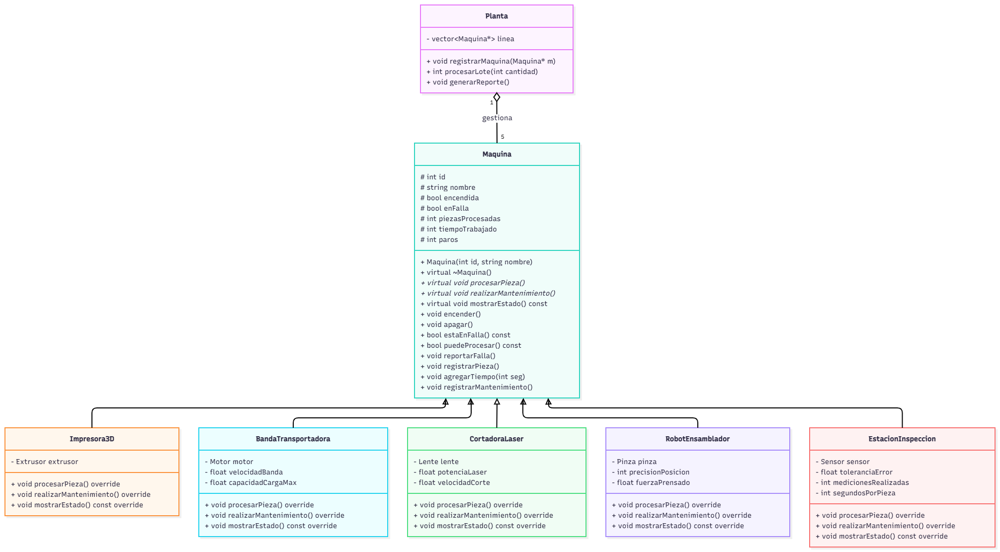

# Propuesta de mejora: [Inserta aquí el título de tu propuesta]

> Crea una carpeta dentro de `docs/mejoras/` con tu número de matrícula como nombre, copia este archivo ahí como `mejora.md` y llena tu copia. No modifiques la plantilla.
>
> La propuesta es solo diseño: no se programa.

**Propuesta de mejora elaborada por:** Jorge Antonio Sadurni Cerdio

## 1. Impacto

**¿Es una mejora o una corrección?**

Es una mejora en la estructura y diseño del código.

**¿Qué observaste en la solución del equipo que dio origen a la propuesta?**

En el código actual, la clase base Maquina no tiene sus métodos marcados como virtual. Debido a esto, cuando la clase Planta guarda un listado de máquinas y trata de llamar a funciones como mostrarEstado(), procesarPieza() o realizarMantenimiento(), el programa ejecuta siempre la versión general de Maquina y no la versión específica de BandaTransportadora.

Esto provoca que la planta no pueda mandar a procesar piezas ni a dar mantenimiento de forma automática a los componentes específicos de cada máquina (como el motor de la banda).

**¿Qué mejora o qué corrige, y por qué vale la pena?**

La propuesta consiste en agregar la palabra virtual en los métodos de la clase Maquina y la palabra override en las clases derivadas como BandaTransportadora.

Vale la pena porque:

Hace que el código sea verdaderamente flexible: Permite que la Planta maneje cualquier tipo de máquina (bandas, brazos robóticos, prensas) usando un solo ciclo, y que cada una responda con su propia lógica automáticamente.

Facilita agregar nuevas máquinas a futuro: Si el día de mañana se crea un nuevo tipo de máquina, no habrá que modificar nada dentro de Planta.cpp.

Evita errores al programar: La palabra override hace que el compilador nos avise inmediatamente si escribimos mal el nombre o los parámetros de una función heredada.

## 2. Qué implica

**Clases nuevas:**

No se requieren clases nuevas. La mejora trabaja sobre las clases que ya tenemos (Planta, Maquina, BandaTransportadora y Motor).

**Comportamiento nuevo en clases existentes:**

En Maquina:

Se agrega la palabra virtual antes de los métodos procesarPieza(), realizarMantenimiento(), mostrarEstado() y en el destructor ~Maquina().

En BandaTransportadora:

Se agrega la palabra override al final de la declaración de esos mismos métodos en el archivo .h para confirmar que se están sobreescribiendo correctamente.

**Interacciones nuevas entre objetos:**

Planta con Maquina: Ahora, cuando la Planta le pida a una máquina m->procesarPieza() o m->realizarMantenimiento(), C++ sabrá automáticamente en tiempo de ejecución que se trata de una BandaTransportadora y ejecutará la función de la banda, desgastando o restaurando la vida de su Motor de forma transparente.

**Relaciones nuevas (herencia, composición o agregación) y por qué son de ese tipo:**

No hay relaciones nuevas, pero se perfecciona la relación de Herencia (BandaTransportadora hereda de Maquina). Al usar virtual y override, la herencia funciona como realmente debe en C++, permitiendo que cualquier máquina derivada reemplace a la clase base sin romper el comportamiento de la planta.

## 3. Diagrama de clases

Diagrama hecho en draw.io que muestre la solución con la mejora incorporada. Distingue lo nuevo de lo existente, por ejemplo con otro color. Guarda la imagen en esta misma carpeta y enlázala aquí.

[]
