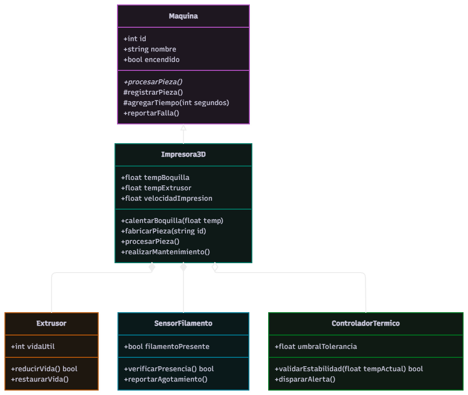

# Propuesta de mejora: Implementación de Control de Calidad Térmico y Sensores de Filamento

> Crea una carpeta dentro de `docs/mejoras/` con tu número de matrícula como nombre, copia este archivo ahí como `mejora.md` y llena tu copia. No modifiques la plantilla.
>
> La propuesta es solo diseño: no se programa.

**Propuesta de mejora elaborada por:** Alejandro Salguero Vega

## 1. Impacto

**¿Es una mejora o una corrección?**

Es una mejora.

**¿Qué observaste en la solución del equipo que dio origen a la propuesta?**

Observé que la `Impresora3D` actual asume que si la temperatura es seteada y el extrusor tiene vida útil, la pieza se fabricará correctamente. Sin embargo, en la realidad, existen fallas comunes como el "atascamiento de filamento" (clogging) o fluctuaciones de temperatura que pueden arruinar una pieza sin que la máquina se "apague" o el componente "muera" técnicamente.

**¿Qué mejora o qué corrige, y por qué vale la pena?**

Propongo agregar un sistema de **Sensores de Estado en Tiempo Real**. Esto permitiría detectar si el filamento se agotó o si la temperatura cayó por debajo del umbral mínimo durante la impresión. Vale la pena porque reduce la tasa de desperdicio de material y evita que la línea de manufactura avance con piezas defectuosas que luego serían rechazadas en la `EstacionInspeccion`.

## 2. Qué implica

**Clases nuevas:**

- `SensorFilamento`: Clase encargada de monitorear la presencia de material. Tendría métodos como `verificarPresencia()` y `reportarAgotamiento()`.
- `ControladorTermico`: Clase para gestionar la estabilidad de la temperatura, capaz de disparar alertas si hay una desviación mayor a +/- 5°C.

**Comportamiento nuevo en clases existentes:**

- `Impresora3D`: El método `procesarPieza()` ahora deberá consultar al `SensorFilamento` y al `ControladorTermico` antes y durante la fabricación. Si alguno reporta un error, la máquina entrará en estado de "Pausa por Error" en lugar de "Falla Total", permitiendo la recarga de material sin necesidad de un mantenimiento completo del extrusor.

**Interacciones nuevas entre objetos:**

- La `Impresora3D` ahora tendrá una relación de dependencia con el `SensorFilamento`.
- El `ControladorTermico` interactuará con los atributos `tempBoquilla` y `tempExtrusor` para validar que los valores reales coincidan con los deseados.

**Relaciones nuevas (herencia, composición o agregación) y por qué son de ese tipo:**

- **Composición** entre `Impresora3D` y `SensorFilamento`: El sensor es una parte integral del hardware de la impresora; si la impresora se destruye, el sensor también.
- **Agregación** entre `Impresora3D` y `ControladorTermico`: El controlador podría ser un módulo externo o actualizable independientemente del chasis de la impresora.

## 3. Diagrama de clases

Diagrama hecho en draw.io que muestre la solución con la mejora incorporada. Distingue lo nuevo de lo existente, por ejemplo con otro color. Guarda la imagen en esta misma carpeta y enlázala aquí.

